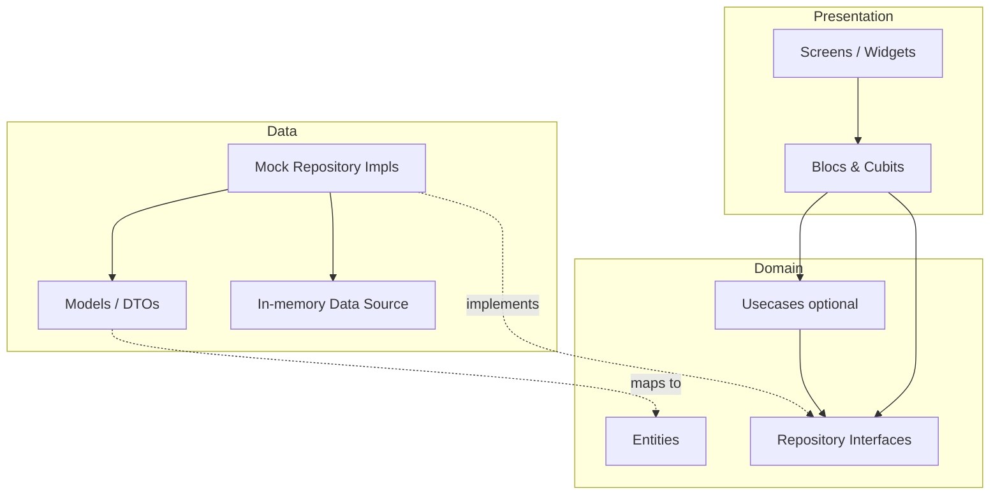
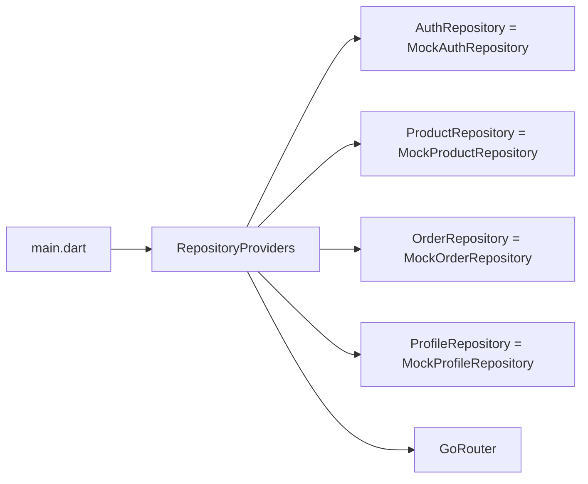
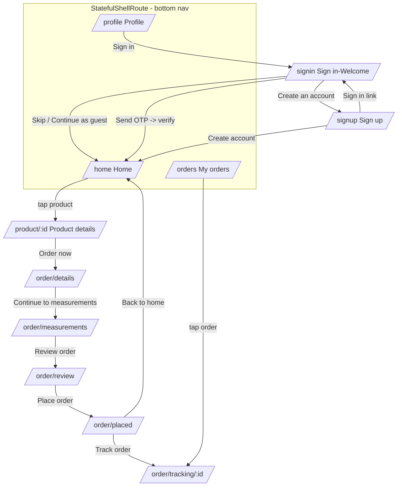
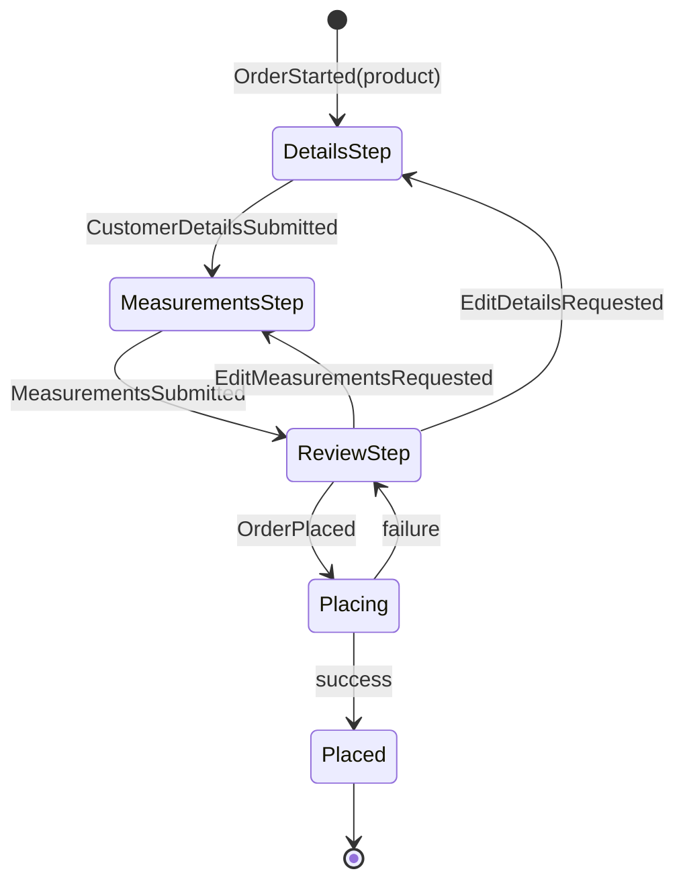

# Design Document: Sanlo Tailoring App

## Overview

Sanlo is a Flutter mobile app for ordering custom-stitched clothing. Customers browse a catalog of tailoring styles, view style details, and place a multi-step order (their details → measurements → review) that is tracked through a stitching timeline until it is ready for pickup. Sign-in is via mobile OTP, with "continue as guest" and email-based account creation as alternatives; there is no online payment (pay by cash/UPI at the shop).

This design covers a fresh Flutter project built from scratch. It uses `flutter_bloc` for state management (Cubits for simple screen state, Blocs with events for the OTP flow and the multi-step order flow), `go_router` for declarative navigation (a 3-tab bottom-navigation shell plus the order sub-flow), and a clean-architecture layering (presentation / domain / data). All screens currently render **dummy/placeholder images** and are backed by **in-memory mock data** exposed through repository interfaces, so the data layer can later be swapped for real API implementations without touching presentation or domain code.

The app ships with 11 screens: Sign in/Welcome, Sign up, Home, My orders, Profile, Product details, Order step 1 (Your details), Order step 2 (Measurements), Order step 3 (Review), Order placed, and Order tracking.

## Architecture

### Layering

The project uses a **feature-first** folder organization with clean-architecture layers inside each feature. Cross-cutting concerns live in `core/`.



**Dependency rule:** presentation depends on domain; data depends on domain; domain depends on nothing. Blocs/Cubits are given repository *interfaces* (never concrete mock classes) through constructor injection, so the mock implementation is swappable for an API implementation later.

### Dependency injection / composition root

A single composition root (`core/di/service_locator.dart`) wires concrete repositories to interfaces. For a project of this size we use a lightweight manual locator (a simple registry, or `get_it` if preferred later); the design below assumes manual constructor injection via `RepositoryProvider` at the top of the widget tree so swapping mock → API is a one-line change in the composition root.



### Folder structure

```
lib/
  main.dart
  app.dart                         # MaterialApp.router + RepositoryProviders + theme
  core/
    di/
      service_locator.dart         # composition root (wires interfaces -> mock impls)
    router/
      app_router.dart              # GoRouter config, route paths, ShellRoute
      app_routes.dart              # route name/path constants
    theme/
      app_colors.dart              # palette (indigo primary, pastel card bgs)
      app_theme.dart               # ThemeData, text theme
      app_spacing.dart             # spacing/radius tokens
    widgets/
      primary_button.dart
      status_badge.dart
      step_indicator.dart
      product_card.dart
      image_placeholder.dart       # dummy image box (icon + optional caption)
      filter_chips.dart
      order_timeline.dart
      section_card.dart
      app_bottom_nav.dart
    utils/
      phone_launcher.dart          # url_launcher wrapper for "Call the shop"
      validators.dart              # phone / otp / email / measurement validation
  features/
    auth/
      domain/
        entities/ (otp_session.dart, auth_user.dart)
        repositories/auth_repository.dart
      data/
        models/ (auth_user_model.dart, otp_session_model.dart)
        repositories/mock_auth_repository.dart
      presentation/
        bloc/ (auth_bloc.dart, auth_event.dart, auth_state.dart)
        screens/ (sign_in_screen.dart, sign_up_screen.dart)
        widgets/
    catalog/                        # products / categories (Home + Product details)
      domain/
        entities/ (product.dart, category.dart, style_detail.dart)
        repositories/product_repository.dart
      data/
        models/, repositories/mock_product_repository.dart
      presentation/
        cubit/ (home_cubit.dart, home_state.dart,
                product_details_cubit.dart, product_details_state.dart)
        screens/ (home_screen.dart, product_details_screen.dart)
        widgets/
    orders/                         # My orders + place-order flow + tracking
      domain/
        entities/ (order.dart, order_status.dart, timeline_step.dart,
                   customer_details.dart, measurement_set.dart, order_draft.dart)
        repositories/order_repository.dart
      data/
        models/, repositories/mock_order_repository.dart
      presentation/
        cubit/ (orders_cubit.dart, orders_state.dart,
                order_tracking_cubit.dart, order_tracking_state.dart)
        bloc/ (place_order_bloc.dart, place_order_event.dart, place_order_state.dart)
        screens/ (my_orders_screen.dart, order_details_step_screen.dart,
                  order_measurements_step_screen.dart, order_review_step_screen.dart,
                  order_placed_screen.dart, order_tracking_screen.dart)
        widgets/
    profile/
      domain/
        entities/user_profile.dart
        repositories/profile_repository.dart
      data/
        models/, repositories/mock_profile_repository.dart
      presentation/
        cubit/ (profile_cubit.dart, profile_state.dart)
        screens/profile_screen.dart
        widgets/
    shell/
      presentation/
        screens/main_shell_screen.dart   # Scaffold + bottom nav for 3 tabs
```

## Navigation Flow

`go_router` drives all navigation. A `StatefulShellRoute` hosts the three bottom-nav tabs (Home, My orders, Profile) so each tab keeps its own navigation stack. Auth screens, product details, the order sub-flow, order placed, and tracking are top-level routes pushed above the shell.



### Route table

| Name | Path | Screen | Notes |
|---|---|---|---|
| `signIn` | `/signin` | `SignInScreen` | Initial location when not "continued"; has Skip |
| `signUp` | `/signup` | `SignUpScreen` | Pushed from sign in |
| `home` | `/home` | `HomeScreen` (shell branch 0) | Catalog + filter chips |
| `myOrders` | `/orders` | `MyOrdersScreen` (shell branch 1) | Active/Completed tabs |
| `profile` | `/profile` | `ProfileScreen` (shell branch 2) | Header + personal details |
| `productDetails` | `/product/:id` | `ProductDetailsScreen` | `id` path param |
| `orderDetails` | `/order/details` | `OrderDetailsStepScreen` | Step 1; guarded by active draft |
| `orderMeasurements` | `/order/measurements` | `OrderMeasurementsStepScreen` | Step 2; guarded |
| `orderReview` | `/order/review` | `OrderReviewStepScreen` | Step 3; guarded |
| `orderPlaced` | `/order/placed` | `OrderPlacedScreen` | Receives placed order id |
| `orderTracking` | `/order/tracking/:id` | `OrderTrackingScreen` | `id` path param |

### Order-in-progress state handling

The multi-step order flow (`/order/details`, `/order/measurements`, `/order/review`) is a single logical transaction. Rather than passing a draft through `extra` on each push (which breaks on deep-link/refresh), a **single `PlaceOrderBloc` instance** is provided above the three step routes and holds the entire `OrderDraft` (product + customer details + measurements) across steps. Options to scope the bloc:

- Provide `PlaceOrderBloc` once at the parent of the three step routes (e.g. a nested shell/`ShellRoute` for `/order`), so all three steps read/write the same instance.
- A `redirect` guard on `/order/*` routes sends the user back to the originating product (or Home) if no `OrderDraft` has been started (prevents entering step 2/3 directly without a product).



## Components and Interfaces

### Repository interfaces (domain layer)

```dart
// features/auth/domain/repositories/auth_repository.dart
abstract interface class AuthRepository {
  /// Requests an OTP for [mobile] (+91). Returns a session (mock: code "0000").
  Future<OtpSession> sendOtp({required String mobile});

  /// Verifies [code] against [sessionId]. Returns the signed-in user on success.
  Future<AuthUser> verifyOtp({required String sessionId, required String code});

  /// Creates an account from the sign-up form (mock: always succeeds).
  Future<AuthUser> createAccount(AuthUser draftUser);

  /// Starts a guest session (no credentials).
  Future<AuthUser> continueAsGuest();

  /// Currently signed-in user, or null/guest if none.
  AuthUser? get currentUser;
}
```

```dart
// features/catalog/domain/repositories/product_repository.dart
abstract interface class ProductRepository {
  Future<List<Category>> getCategories();            // All, Women, Men, Kids
  Future<List<Product>> getProducts({Category? filter}); // filter == All -> every product
  Future<StyleDetail> getProductDetail(String productId);
}
```

```dart
// features/orders/domain/repositories/order_repository.dart
abstract interface class OrderRepository {
  Future<List<Order>> getOrders({OrderBucket bucket}); // active | completed
  Future<Order> getOrderById(String orderId);
  Future<Order> placeOrder(OrderDraft draft);          // mock: assigns id #SN-####
  Future<List<TimelineStep>> getTimeline(String orderId);
}

enum OrderBucket { active, completed }
```

```dart
// features/profile/domain/repositories/profile_repository.dart
abstract interface class ProfileRepository {
  Future<UserProfile> getProfile();
  Future<UserProfile> updateProfile(UserProfile profile); // mock: echoes back
}
```

### Core reusable widgets

| Widget | Purpose |
|---|---|
| `PrimaryButton` | Full-width indigo CTA; supports loading + disabled state |
| `StatusBadge` | Colored pill for order status (In progress / Ready / Completed) |
| `StepIndicator` | "Step N of 3 · Label" header with progress segments |
| `ProductCard` | 2-col grid card: image placeholder, category, name, rating, days, price |
| `ImagePlaceholder` | Dummy image box (icon + optional caption like "[Photo 1 of 4]") |
| `CategoryFilterChips` | Horizontally scrollable selectable chips (All/Women/Men/Kids) |
| `OrderTimeline` | Vertical timeline with done/current/pending nodes + timestamps |
| `SectionCard` | Rounded pastel container used for "Your details", "Measurements" etc. |
| `AppBottomNav` | 3-tab bottom navigation bar (Home, My orders, Profile) |

## Data Models

### Domain entities

```dart
// catalog
enum CategoryKind { all, women, men, kids }

class Category extends Equatable {
  final CategoryKind kind;
  final String label;            // "All", "Women", "Men", "Kids"
  // all == sentinel meaning "no filter"
}

class Product extends Equatable {
  final String id;               // "p_blouse"
  final CategoryKind category;   // women / men / kids
  final String name;             // "Designer Blouse"
  final String typeLabel;        // "Blouse", "Kurti", "Shirt"...
  final double rating;           // 4.8
  final int readyInDays;         // e.g. 5
  final int priceInr;            // 650
  final int imageCount;          // 4  (for "[Photo x of 4]")
}

class StyleDetail extends Equatable {
  final Product product;
  final String categoryLabel;    // "Women"
  final String aboutText;        // "About this style" description
  final List<String> included;   // checklist items
  final List<String> variantLabels; // color/variant thumbnails
  final int stitchingChargeInr;  // bottom bar charge
  final String paymentLabel;     // "At shop"
}

// orders
class CustomerDetails extends Equatable {
  final String fullName;
  final String mobile;           // +91...
  final String? email;           // optional
  final String? address;         // optional
}

class MeasurementSet extends Equatable {
  final bool knowsMeasurements;  // false => "Not sure", fields skipped
  final double? bust;
  final double? waist;
  final double? shoulder;
  final double? sleeveLength;
  final double? armhole;
  final double? blouseLength;    // all in inches
  final String? designNotes;     // optional
}

/// Mutable-by-copy aggregate carried across the 3 order steps.
class OrderDraft extends Equatable {
  final Product product;
  final CustomerDetails? details;      // set in step 1
  final MeasurementSet? measurements;  // set in step 2
  // completeness: isReadyToPlace == details != null && measurements != null
}

enum OrderStatus { placed, inProgress, ready, completed }

enum TimelineStage {
  orderPlaced, measurementDone, stitchingStarted,
  stitchingFinished, finalTouchUp, allSet,
}

enum StepState { done, current, pending }

class TimelineStep extends Equatable {
  final TimelineStage stage;
  final String label;            // "Order placed", "Measurement done"...
  final StepState state;
  final DateTime? timestamp;     // null while pending
}

class Order extends Equatable {
  final String id;               // "SN-1048" -> displayed "#SN-1048"
  final Product product;
  final DateTime placedDate;
  final OrderStatus status;
  final double progress;         // 0.0..1.0 for the progress bar
  final String nextStep;         // "Stitching started", "Ready for pickup"...
  final int amountAtShopInr;     // pay at shop
  final DateTime expectedReady;
}

// profile
enum Gender { female, male, other }

class UserProfile extends Equatable {
  final String firstName;
  final String lastName;
  final String mobile;
  final String? email;
  final Gender? gender;
  final int totalOrders;         // stats
  final int inProgress;
  final int ready;
}

// auth
class OtpSession extends Equatable {
  final String sessionId;
  final String mobile;
  final DateTime expiresAt;
}

class AuthUser extends Equatable {
  final String? id;              // null => guest
  final bool isGuest;
  final String? mobile;
  final String? firstName;
  final String? lastName;
  final String? email;
  final Gender? gender;
}
```

### Mock data (matches the mockups)

`MockProductRepository` seeds an in-memory catalog:

| id | category | name | type | rating | ready | price |
|---|---|---|---|---|---|---|
| p_blouse | women | Designer Blouse | Blouse | 4.8 | 5 | ₹650 |
| p_anarkali | women | Anarkali Kurti | Kurti | 4.7 | 7 | ₹900 |
| p_shirt | men | Formal Shirt | Shirt | 4.6 | 4 | ₹550 |
| p_kurta | men | Kurta Pajama | Kurta set | 4.8 | 6 | ₹1000 |
| p_frock | kids | Kids Frock | Frock | 4.9 | 3 | ₹450 |
| p_salwar | women | Salwar Suit | Suit | 4.7 | 8 | ₹1100 |

`MockOrderRepository` seeds orders such as `#SN-1048` (Designer Blouse, In progress, next "Stitching started") in the active bucket and at least one completed order, plus a timeline for tracking:

```
Order placed (done)      -> Measurement done (done) -> Stitching started (current)
-> Stitching finished (pending) -> Final touch-up (pending) -> All set (pending)
```

`MockProfileRepository` seeds a guest-ish profile with stats (Total orders, In progress, Ready) and personal details (Name, Mobile, Email, Gender).

`MockAuthRepository` accepts any +91 mobile, returns an `OtpSession`, and verifies the fixed mock code `"0000"`.

Mapping: `data/models/*` are thin DTOs (`fromJson`/`toJson` ready for the future API) with `toEntity()` / `fromEntity()` converters. Mock repos build DTOs from hard-coded maps, exactly as a real API layer would deserialize responses.

## BLoC / Cubit Inventory

| Class | Type | Screen(s) | Responsibility |
|---|---|---|---|
| `AuthBloc` | Bloc | Sign in, Sign up | OTP send/verify, guest, create account |
| `HomeCubit` | Cubit | Home | Load categories+products, apply filter, search |
| `ProductDetailsCubit` | Cubit | Product details | Load style detail, selected variant/photo index |
| `OrdersCubit` | Cubit | My orders | Load orders, switch active/completed bucket |
| `PlaceOrderBloc` | Bloc | Order steps 1–3 | Multi-step order state machine (OrderDraft) |
| `OrderTrackingCubit` | Cubit | Order tracking | Load order header + timeline |
| `ProfileCubit` | Cubit | Profile | Load profile + stats, (optional) save edits |

### AuthBloc (events / states)

```dart
// events
sealed class AuthEvent {}
class OtpRequested      extends AuthEvent { final String mobile; }
class OtpVerified       extends AuthEvent { final String code; }
class GuestRequested    extends AuthEvent {}
class AccountSubmitted  extends AuthEvent { final AuthUser draft; }
class AuthReset         extends AuthEvent {}

// state (single object with a phase enum — easy to test transitions)
enum AuthPhase { idle, sendingOtp, otpSent, verifying, authenticated, creating, error }

class AuthState extends Equatable {
  final AuthPhase phase;
  final OtpSession? session;      // present once otpSent
  final AuthUser? user;           // present once authenticated
  final String? errorMessage;
}
```

```pascal
PROCEDURE on OtpRequested(e, emit)
BEGIN
  IF NOT isValidIndianMobile(e.mobile) THEN
    emit(state WITH phase = error, errorMessage = "Enter a valid 10-digit mobile")
    RETURN
  END IF
  emit(state WITH phase = sendingOtp)
  session <- authRepository.sendOtp(mobile = e.mobile)
  emit(state WITH phase = otpSent, session = session, errorMessage = null)
END

PROCEDURE on OtpVerified(e, emit)
BEGIN
  IF state.session = NULL THEN RETURN   // cannot verify before sending
  emit(state WITH phase = verifying)
  TRY
    user <- authRepository.verifyOtp(sessionId = state.session.sessionId, code = e.code)
    emit(state WITH phase = authenticated, user = user)
  CATCH InvalidOtp
    emit(state WITH phase = error, errorMessage = "Incorrect code")
  END TRY
END

PROCEDURE on GuestRequested(e, emit)
BEGIN
  user <- authRepository.continueAsGuest()
  emit(state WITH phase = authenticated, user = user)   // user.isGuest == true
END

PROCEDURE on AccountSubmitted(e, emit)
BEGIN
  emit(state WITH phase = creating)
  user <- authRepository.createAccount(e.draft)
  emit(state WITH phase = authenticated, user = user)
END
```

### PlaceOrderBloc (events / states) — the multi-step state machine

```dart
// events
sealed class PlaceOrderEvent {}
class OrderStarted              extends PlaceOrderEvent { final Product product; }
class CustomerDetailsSubmitted  extends PlaceOrderEvent { final CustomerDetails details; }
class MeasurementsSubmitted     extends PlaceOrderEvent { final MeasurementSet measurements; }
class EditDetailsRequested      extends PlaceOrderEvent {}
class EditMeasurementsRequested extends PlaceOrderEvent {}
class OrderPlaced               extends PlaceOrderEvent {}

// state
enum OrderStep { details, measurements, review, placing, placed }

class PlaceOrderState extends Equatable {
  final OrderStep step;
  final OrderDraft draft;        // product + optional details + optional measurements
  final Order? placedOrder;      // set once placed
  final String? errorMessage;
}
```

```pascal
PROCEDURE on OrderStarted(e, emit)
BEGIN
  draft <- OrderDraft(product = e.product, details = NULL, measurements = NULL)
  emit(PlaceOrderState(step = details, draft = draft))
END

PROCEDURE on CustomerDetailsSubmitted(e, emit)
BEGIN
  // only valid while on details or review (edit) step
  newDraft <- state.draft.copyWith(details = e.details)
  emit(state WITH draft = newDraft, step = measurements)
END

PROCEDURE on MeasurementsSubmitted(e, emit)
BEGIN
  // "Not sure" => knowsMeasurements=false, all fields may be null => still valid
  newDraft <- state.draft.copyWith(measurements = e.measurements)
  emit(state WITH draft = newDraft, step = review)
END

PROCEDURE on EditDetailsRequested(e, emit)
BEGIN
  emit(state WITH step = details)        // draft preserved
END

PROCEDURE on EditMeasurementsRequested(e, emit)
BEGIN
  emit(state WITH step = measurements)   // draft preserved
END

PROCEDURE on OrderPlaced(e, emit)
BEGIN
  IF NOT state.draft.isReadyToPlace THEN     // details != null AND measurements != null
    emit(state WITH errorMessage = "Complete all steps first")
    RETURN
  END IF
  emit(state WITH step = placing)
  TRY
    order <- orderRepository.placeOrder(state.draft)
    emit(state WITH step = placed, placedOrder = order, errorMessage = null)
  CATCH e
    emit(state WITH step = review, errorMessage = "Could not place order, try again")
  END TRY
END
```

### HomeCubit (filter + search)

```dart
class HomeState extends Equatable {
  final bool loading;
  final List<Category> categories;
  final List<Product> allProducts;
  final CategoryKind selectedFilter;   // default: all
  final String query;                  // search text
  List<Product> get visibleProducts;   // derived: filter by category + name query
  final String? error;
}
```

```pascal
PROCEDURE applyFilter(kind)
  emit(state WITH selectedFilter = kind)   // visibleProducts recomputed

PROCEDURE search(text)
  emit(state WITH query = text)

FUNCTION visibleProducts()  // derived getter, pure
BEGIN
  result <- allProducts
  IF selectedFilter <> all THEN
    result <- [p IN result WHERE p.category = selectedFilter]
  END IF
  IF query is non-empty THEN
    result <- [p IN result WHERE p.name CONTAINS query (case-insensitive)]
  END IF
  RETURN result
END
```

### OrdersCubit, ProductDetailsCubit, OrderTrackingCubit, ProfileCubit

```dart
class OrdersState extends Equatable {
  final bool loading;
  final OrderBucket bucket;            // active | completed
  final List<Order> active;
  final List<Order> completed;
  List<Order> get visible;             // bucket == active ? active : completed
  final String? error;
}

class ProductDetailsState extends Equatable {
  final bool loading;
  final StyleDetail? detail;
  final int selectedPhotoIndex;        // 0-based, < detail.product.imageCount
  final int selectedVariantIndex;
  final String? error;
}

class OrderTrackingState extends Equatable {
  final bool loading;
  final Order? order;
  final List<TimelineStep> timeline;   // exactly one step has state == current (if not completed)
  final String? error;
}

class ProfileState extends Equatable {
  final bool loading;
  final UserProfile? profile;
  final bool editing;
  final String? error;
}
```

## Key Widget Signatures

```dart
class PrimaryButton extends StatelessWidget {
  const PrimaryButton({
    required this.label,
    required this.onPressed,     // null => disabled
    this.loading = false,
    this.icon,
  });
}

class ProductCard extends StatelessWidget {
  const ProductCard({required this.product, required this.onTap});
  // renders ImagePlaceholder + category + name + rating + "$readyInDays days" + "₹$priceInr"
}

class ImagePlaceholder extends StatelessWidget {
  const ImagePlaceholder({
    this.icon = Icons.checkroom,   // t-shirt-ish icon
    this.caption,                  // e.g. "[Photo 1 of 4]"
    this.height,
    this.borderRadius,
  });
}

class StatusBadge extends StatelessWidget {
  const StatusBadge({required this.status});  // maps OrderStatus -> color + label
}

class StepIndicator extends StatelessWidget {
  const StepIndicator({required this.currentStep, this.totalSteps = 3, required this.label});
}

class CategoryFilterChips extends StatelessWidget {
  const CategoryFilterChips({
    required this.categories,
    required this.selected,
    required this.onSelected,      // ValueChanged<CategoryKind>
  });
}

class OrderTimeline extends StatelessWidget {
  const OrderTimeline({required this.steps});  // List<TimelineStep>
}

class MainShellScreen extends StatelessWidget {
  const MainShellScreen({required this.navigationShell}); // StatefulNavigationShell
}
```

### Route definitions (go_router)

```dart
final router = GoRouter(
  initialLocation: Routes.signIn,          // '/signin'
  routes: [
    GoRoute(path: Routes.signIn,  name: 'signIn',  builder: (c, s) => const SignInScreen()),
    GoRoute(path: Routes.signUp,  name: 'signUp',  builder: (c, s) => const SignUpScreen()),

    // 3-tab bottom-nav shell
    StatefulShellRoute.indexedStack(
      builder: (c, s, shell) => MainShellScreen(navigationShell: shell),
      branches: [
        StatefulShellBranch(routes: [
          GoRoute(path: Routes.home, name: 'home', builder: (c, s) => const HomeScreen()),
        ]),
        StatefulShellBranch(routes: [
          GoRoute(path: Routes.orders, name: 'myOrders', builder: (c, s) => const MyOrdersScreen()),
        ]),
        StatefulShellBranch(routes: [
          GoRoute(path: Routes.profile, name: 'profile', builder: (c, s) => const ProfileScreen()),
        ]),
      ],
    ),

    GoRoute(path: '/product/:id', name: 'productDetails',
      builder: (c, s) => ProductDetailsScreen(productId: s.pathParameters['id']!)),

    // Order sub-flow: one PlaceOrderBloc provided above all three steps.
    ShellRoute(
      builder: (c, s, child) => BlocProvider(
        create: (_) => PlaceOrderBloc(orderRepository: c.read()),
        child: child,
      ),
      routes: [
        GoRoute(path: '/order/details',      name: 'orderDetails',      builder: ...),
        GoRoute(path: '/order/measurements', name: 'orderMeasurements', builder: ...,
          redirect: (c, s) => _requireDraftWithProduct(c)),
        GoRoute(path: '/order/review',       name: 'orderReview',       builder: ...,
          redirect: (c, s) => _requireDetailsAndMeasurements(c)),
      ],
    ),

    GoRoute(path: '/order/placed', name: 'orderPlaced',
      builder: (c, s) => OrderPlacedScreen(orderId: s.uri.queryParameters['id']!)),
    GoRoute(path: '/order/tracking/:id', name: 'orderTracking',
      builder: (c, s) => OrderTrackingScreen(orderId: s.pathParameters['id']!)),
  ],
);
```

## Example Usage

```dart
// Home: tapping a product navigates to details by id
ProductCard(
  product: product,
  onTap: () => context.pushNamed('productDetails', pathParameters: {'id': product.id}),
);

// Product details: start the order flow
PrimaryButton(
  label: 'Order now',
  onPressed: () {
    context.pushNamed('orderDetails');          // enters the /order ShellRoute
    context.read<PlaceOrderBloc>().add(OrderStarted(product: detail.product));
  },
);

// Order step 1 -> 2
PrimaryButton(
  label: 'Continue to measurements',
  onPressed: () {
    context.read<PlaceOrderBloc>()
        .add(CustomerDetailsSubmitted(details: formDetails));
    context.pushNamed('orderMeasurements');
  },
);

// "Call the shop" on tracking screen
PrimaryButton(
  label: 'Call the shop',
  icon: Icons.call,
  onPressed: () => PhoneLauncher.call('+919000000000'),
);
```

```dart
// core/utils/phone_launcher.dart
class PhoneLauncher {
  static Future<void> call(String number) async {
    final uri = Uri(scheme: 'tel', path: number);
    if (await canLaunchUrl(uri)) {
      await launchUrl(uri);
    }
  }
}
```

## Correctness Properties

These properties are stated with universal quantification and are suitable for property-based testing (e.g. using the `glados` package for Dart, or table/example tests where a generator is impractical). Each property names the component it constrains and the requirement it validates. Requirement IDs follow the numbering the requirements phase will produce: 1 = Authentication & onboarding, 2 = Catalog/Home browsing, 3 = Product details, 4 = Place-order flow, 5 = My orders, 6 = Order tracking, 7 = Profile, 8 = Data layer / repository abstraction.

### Property 1: Filter soundness (HomeCubit)

For all catalogs `C` and filters `k ≠ all`, every product in `visibleProducts` satisfies `product.category == k`: `∀ p ∈ visibleProducts(C, k) : p.category == k`.

**Validates: Requirements 2.2**

### Property 2: Filter completeness (HomeCubit)

For filter `all` with empty query, `visibleProducts` equals `allProducts` as a set: `∀ C : visibleProducts(C, all, "") == C`.

**Validates: Requirements 2.2**

### Property 3: Search is a refinement (HomeCubit)

For any query `q`, `visibleProducts(C, k, q) ⊆ visibleProducts(C, k, "")`. Narrowing the query never adds products.

**Validates: Requirements 2.3**

### Property 4: Search case-insensitive membership (HomeCubit)

For any product `p` and query `q` where `p.name.toLowerCase()` contains `q.toLowerCase()`, if `p` passes the category filter then `p ∈ visibleProducts`.

**Validates: Requirements 2.3**

### Property 5: No verify before send (AuthBloc)

From any state where `session == null`, applying `OtpVerified` does not transition to `authenticated`: `∀ s : s.session == null ⟹ verify(s).phase ≠ authenticated`.

**Validates: Requirements 1.1**

### Property 6: OTP correctness (AuthBloc)

`verifyOtp` yields `authenticated` iff the supplied code equals the session's expected code; otherwise `error`: `∀ code : (code == expected) ⟺ phase == authenticated`.

**Validates: Requirements 1.1**

### Property 7: Guest is always authenticated-as-guest (AuthBloc)

`GuestRequested` always reaches `phase == authenticated ∧ user.isGuest == true`.

**Validates: Requirements 1.2**

### Property 8: Terminal auth (AuthBloc)

Once `phase == authenticated`, no event other than `AuthReset` changes `user` to a different identity.

**Validates: Requirements 1.3**

### Property 9: Step monotonicity until review (PlaceOrderBloc)

The forward transitions produce the ordered sequence `details → measurements → review`; `CustomerDetailsSubmitted` always lands on `measurements`, and `MeasurementsSubmitted` always lands on `review`.

**Validates: Requirements 4.1**

### Property 10: Draft preservation on edit (PlaceOrderBloc)

`EditDetailsRequested` / `EditMeasurementsRequested` change only `step`, never discarding previously captured `details` or `measurements`: `∀ s : edit(s).draft == s.draft`.

**Validates: Requirements 4.4**

### Property 11: Place requires completeness (PlaceOrderBloc)

`OrderPlaced` transitions to `placed` only if `draft.details != null ∧ draft.measurements != null`; otherwise it stays (no `placedOrder`): `∀ s : placed(s) ⟹ s.draft.isReadyToPlace`.

**Validates: Requirements 4.5**

### Property 12: "Not sure" is valid (PlaceOrderBloc)

A `MeasurementSet` with `knowsMeasurements == false` and all numeric fields null is accepted by step 2 and permits placing the order (completeness only requires the object to be present, not its fields filled).

**Validates: Requirements 4.3**

### Property 13: Placed order identity (PlaceOrderBloc)

On success, `placedOrder.product == draft.product` and `placedOrder.id` matches the `#SN-####` format.

**Validates: Requirements 4.6**

### Property 14: Single current for non-completed orders (OrderTracking)

For any non-completed order, exactly one `TimelineStep` has `state == current`; for completed orders, zero steps are `current` and all are `done`: `count(steps, current) ∈ {0,1}` and `== 0 ⟺ order.status == completed`.

**Validates: Requirements 6.2**

### Property 15: Monotone timeline (OrderTracking)

`done` steps precede the `current` step, which precedes all `pending` steps (no `pending` appears before a `done`). The timeline stages follow the fixed order `orderPlaced < measurementDone < stitchingStarted < stitchingFinished < finalTouchUp < allSet`.

**Validates: Requirements 6.2**

### Property 16: Timestamps match state (OrderTracking)

Every `done` or `current` step has a non-null `timestamp`; every `pending` step has a null `timestamp`.

**Validates: Requirements 6.2**

### Property 17: Interface substitutability (repository swap)

Any Bloc/Cubit behaves identically when given a mock repository or a future API repository, provided both honor the interface contract (same entity shapes, same error types). No presentation/domain code references concrete `Mock*` classes.

**Validates: Requirements 8.1**

## Error Handling

| Scenario | Condition | Response | Recovery |
|---|---|---|---|
| Invalid mobile on Send OTP | `mobile` not a valid 10-digit +91 number | `AuthState.error` with inline message; button stays enabled | User corrects number and retries |
| Wrong OTP | `code != expected` | `AuthState.error` "Incorrect code" | Re-enter code or resend OTP |
| Enter order step 2/3 without a product/draft | Deep-link/refresh with no `OrderDraft` | `go_router` `redirect` back to Home (or product) | Restart from Product details |
| Place order fails (mock throws / future API error) | Repository error on `placeOrder` | Return to `review` step with error banner | Retry "Place order" |
| Product/order not found by id | Unknown `:id` in `/product/:id` or `/order/tracking/:id` | Cubit emits `error`; screen shows "Not found" with back action | Navigate back |
| Phone dialer unavailable | `canLaunchUrl(tel:)` is false | Silently no-op (or snackbar "Can't place call") | User calls manually |

All repository methods surface failures as typed exceptions (e.g. `NotFoundFailure`, `InvalidOtpFailure`) so Blocs can map them to specific messages; the mock implementations throw the same types the API layer will.

## Testing Strategy

### Unit testing
- **Entities / derived getters:** `HomeState.visibleProducts`, `OrdersState.visible`, `OrderDraft.isReadyToPlace`, `copyWith` correctness.
- **Mock repositories:** seed data shape (6 products with the listed prices, orders including `#SN-1048`, 6-stage timeline), filter behavior, `placeOrder` id generation.
- **Blocs/Cubits with `bloc_test`:** assert emitted state sequences for each event (OTP flow, order flow transitions, filter changes, bucket switch).

### Property-based testing
- **Library:** `glados` (Dart) for generated inputs; fall back to parameterized example tests where generators are heavy.
- Encode properties **P1–P16** as tests. Generators: random catalogs of products across categories, random query strings (incl. substrings of names), random event sequences for the two state machines, random timelines.
- Key generators: `anyProduct`, `anyCatalog`, `anyCategoryFilter`, `anyAuthEventSequence`, `anyOrderEventSequence`, `anyTimeline`.

### Widget / integration testing
- Golden-ish structural tests for `ProductCard`, `StatusBadge`, `StepIndicator`, `OrderTimeline` rendering the right text/colors.
- `go_router` navigation tests: tapping a product reaches `/product/:id`; the three order steps advance and the redirect guards block direct access; "Back to home" returns to the shell.
- Integration smoke test: guest → Home → product → order steps → placed → tracking.

## Performance Considerations

- Catalog is small and in-memory; no pagination needed now. Filtering/search are O(n) pure computations on a short list — fine to recompute in a derived getter per build.
- `StatefulShellRoute.indexedStack` keeps tab state alive; acceptable memory for 3 light screens.
- Image placeholders are zero-cost (no network/decoding). When real images arrive, introduce cached network images behind the same `ImagePlaceholder` API.

## Security Considerations

- No real auth/payment yet. Mock OTP uses a fixed code and must be replaced before production; the fixed code and any mock secrets must never ship in a release build (guard behind a build flavor).
- No online payment path exists by design (cash/UPI at shop), reducing PCI scope.
- `tel:` launches are user-initiated; the shop number is a constant, not user-supplied, avoiding injection via `url_launcher`.
- When the API layer lands: store tokens in secure storage, send OTP over TLS, and validate/escape any server-provided strings before display.

## Dependencies

Add to `pubspec.yaml` (`dependencies`):

```yaml
flutter_bloc: ^8.1.6     # Cubit + Bloc state management
go_router: ^14.2.0       # declarative routing + StatefulShellRoute bottom nav
equatable: ^2.0.5        # value equality for entities and states
url_launcher: ^6.3.0     # "Call the shop" tel: action
```

`dev_dependencies`:

```yaml
bloc_test: ^9.1.7        # testing Bloc/Cubit state sequences
mocktail: ^1.0.4         # mocking repositories in tests
glados: ^1.1.6           # property-based testing (properties P1–P16)
```

Platform config for `url_launcher` phone calls:
- **iOS** (`ios/Runner/Info.plist`): add `LSApplicationQueriesSchemes` with `tel`.
- **Android**: add a `<queries>` entry for the `tel` intent in `AndroidManifest.xml` (Android 11+).

Notes:
- Versions are pinned to current stable majors compatible with Dart SDK `^3.9.2`; run `flutter pub get` and `flutter pub outdated` to confirm before implementation.
- No image/asset bundle is needed yet (dummy placeholders only). When real assets arrive, add an `assets:` section and swap `ImagePlaceholder` internals.
